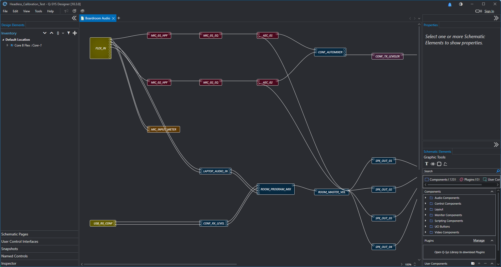

# qsys-designer-mcp

An MCP server that lets Claude, or any other MCP client, build Q-SYS designs. You describe a system, and it writes a real `.qsys` file through Designer's own libraries, reads it back to check the wiring, runs it in Designer's emulator and tests the control logic live over QRC.

> **Unofficial.** This project is not made, endorsed or supported by QSC. "Q-SYS" is a trademark of QSC, LLC. Read [Licensing and QSC](#licensing-and-qsc) before using it.



## What it can do

- **Build designs headlessly.** A JSON spec in, a `.qsys` file out, in about a second, with no Designer window. It supports:
  - components by class name and their properties
  - Core and inventory I/O: Flex, Mic/Line, USB audio and HID, Software Dante, AES67
  - wires, by pin number or pin name
  - stored control values
  - Text Controllers with your Lua and custom controls
  - snapshot banks and their controllers
  - multi-page schematics and multi-page UCIs
- **Look things up.** `probe_components` tells you a component class's properties, pins and controls, and what I/O a Core offers. Claude doesn't have to guess names.
- **Read any design back,** including ones it didn't build: components, properties, stored values, pins, wires, UCIs and snapshot banks.
- **Check signal flow statically** over the real wiring, for example "mic 1 reaches the USB send", "the laptop never reaches the far end", "the echo canceller's reference carries the far end", or "no unconnected pins".
- **Emulate and test.** It opens a test copy in Designer's emulator with every block visible to QRC, then reads and sets controls to test modes, mutes and script logic.
- **Calibrate stored values.** It measures what the engine actually loads for each stored value and fixes the file if needed (more on why below).
- **Save snapshots.** Only the engine writes snapshot data, so `save_snapshots` saves a spec's snapshot values on the emulator and keeps what Designer collects.

It works with Designer **9.x** and **10.x**, and has been tested with 9.13.1 and 10.3.0. Files are read with the version that saved them. New builds use the newest install unless you pick one.

## Requirements

- Windows 10 or 11
- Q-SYS Designer 9.x or later, installed normally. 10.x brings its own .NET 8 runtime with it.
- Python 3.11 or later, or [uv](https://docs.astral.sh/uv/)

## Install

The commands below use `uvx`, which comes with [uv](https://docs.astral.sh/uv/). If you don't have it, install it first (`winget install astral-sh.uv`) and restart your terminal or Claude app so it's on PATH. Without it, the client reports the server as failing with "Connection closed".

### Claude Code

```bash
claude mcp add qsys -- uvx --from git+https://github.com/nerif-tafu/qsys-designer-mcp qsys-designer-mcp
```

### Claude Desktop

Add this to `claude_desktop_config.json` (Settings > Developer > Edit Config), then restart Claude Desktop:

```json
{
  "mcpServers": {
    "qsys": {
      "command": "uvx",
      "args": ["--from", "git+https://github.com/nerif-tafu/qsys-designer-mcp", "qsys-designer-mcp"]
    }
  }
}
```

### Without uv

```bash
pip install git+https://github.com/nerif-tafu/qsys-designer-mcp
```

Then point your client at the `qsys-designer-mcp` command that pip installs. Any MCP client that can start a stdio server works the same way: Cursor, VS Code and so on.

### Settings (environment variables, all optional)

| Variable | What it does |
|---|---|
| `QSYS_DESIGNER_DIR` | Use this Designer folder instead of picking one automatically |
| `QSYS_QRC_HOST`, `QSYS_QRC_PORT` | Where QRC is (default `127.0.0.1:1710`, i.e. Designer's emulator) |
| `QSYS_QRC_USER`, `QSYS_QRC_PASSWORD` | For a Core with access control turned on |
| `QSYS_MCP_CACHE` | Where the compiled helper, measured positions and test copies go (default `%LOCALAPPDATA%\qsys-designer-mcp`) |

## Using it

Ask for a system the way you'd brief a programmer. For example:

- "Design a boardroom for 12 people: two ceiling mics with echo cancelling, a Teams PC on USB, a laptop input, four ceiling speakers and a touch panel with Meeting, Presentation and Room Off. Save it as a new file and test it."
- "Read `C:\Jobs\Hall.qsys` and tell me whether the AEC references are wired correctly."
- "Add a lectern mic to this spec and rebuild it as v2."

Claude will usually:

1. Read `qsys://spec-format` and probe the classes it needs.
2. Write a spec and build it to a new file.
3. Read the file back and run `check_design` on it.
4. Emulate it and test the control logic over QRC.
5. Calibrate stored values if any are unconfirmed.

[`examples/boardroom.json`](examples/boardroom.json) is a complete spec: 30 blocks, 51 wires, a 41-element UCI and a Lua state machine. Its checks and runtime tests are next to it. The results from both Designer versions are in [`docs/example-results`](docs/example-results).

[`docs/showcase-prompt.md`](docs/showcase-prompt.md) is a much bigger brief: a divisible ballroom with about 220 components. Paste it into a new conversation to see what the server can do.

## How it works

Designer has no public API for editing designs. It does ship as a .NET program, though, and its own classes can create, save and load designs. This server uses them through a small helper program:

- **Designer 9.x (.NET Framework):** the helper is compiled from the C# source in [`src/qsys_mcp/helper`](src/qsys_mcp/helper) on first use. It uses the compiler that comes with Windows, and is built against the Designer version you have.
- **Designer 10.x (.NET 8):** a prebuilt helper is used. It loads Designer purely by reflection, and runs on the same .NET runtime as Designer.

Each tool call runs the helper once with a JSON request. Nothing from QSC is included in this repo or the package.

The Designer app itself is only used to run designs: opening, emulating, stopping, answering dialogs and taking screenshots. Menus and dialog buttons are pressed through Windows UI Automation, so the server never moves your mouse or types. Designer opens every file in its own window, so `open_design` and `emulate_design` close the running Designer first, so there's only ever one open. If a design has unsaved changes, they stop and say so instead.

### Stored values

When a design starts, the engine applies each stored control's position (0 to 1 along the control's range), not its value. The mapping from value to position differs between controls. Get it wrong and a value reads back fine from the file but comes up wrong when the design runs.

The builder uses measured rules where they're known, and lists anything else as unconfirmed. `calibrate_values` then sets each value on the engine, reads the position back, fixes the file, restarts and checks every value came up as stored. The measurements are cached per Designer version, so a control only has to be measured once.

Some controls are linked. For example, the Flex inputs' preamp gain and sensitivity move together. Calibration reports these, because the value looks right when set live but is wrong after a restart.

## Safety and privacy

- **It won't overwrite your files.** `build_design` won't replace an existing file unless it's explicitly told to. Calibration only changes stored positions, in the file you point it at. Testing uses a copy in the cache folder.
- **It won't throw away your work.** It never discards unsaved changes in Designer unless told to (`discard_changes=True`). Claude should only do that when you've said the changes don't matter. Stopping emulation counts as a change, because Designer records the control values from the run.
- **QRC can change a live system.** `qrc_set_control` and `qrc_set_named_control` change live values. Against the emulator that's harmless. If you point `QSYS_QRC_HOST` at a real Core, they change a working system.
- **Screenshots leave your machine.** The `screenshot` tool sends a picture of the Designer window to the AI model you're using. Design files themselves are read locally, and only what a tool returns is sent.
- **Every tool is labelled.** Each one is marked read-only, writes files, or changes live state, so your client can ask before the risky ones.

## Licensing and QSC

The code in this repo is MIT-licensed (see [LICENSE](LICENSE)).

To build and read designs, it loads Q-SYS Designer's own assemblies at run time and calls internal classes that QSC doesn't document or support. QSC's licence agreement for Designer may restrict reverse engineering or this kind of use. I'm not a lawyer and this isn't legal advice: read the agreement that came with your copy of Designer and decide for yourself whether your use is acceptable.

Because it relies on undocumented internals, any Designer update could break it. No QSC code or binaries are distributed here: the helper is built against, or loads, the Designer you already have installed. If QSC objects, the project will be changed or taken down.

## Tools

| Area | Tools |
|---|---|
| Learn | `designer_versions`, `probe_components` |
| Build and check | `build_design`, `read_design`, `check_design` |
| Run | `designer_status`, `open_design`, `close_design`, `emulate_design`, `stop_emulation`, `list_dialogs`, `dialog_button`, `screenshot` |
| Stored values | `calibrate_values`, `save_snapshots` |
| Runtime (QRC) | `qrc_status`, `qrc_list_components`, `qrc_get_controls`, `qrc_set_control`, `qrc_named_controls`, `qrc_set_named_control`, `qrc_watch` |
| Lua | `lua_check`, `new_plugin` |

There are three resources, `qsys://spec-format`, `qsys://lua-api` and `qsys://design-guide`, plus a `review_design` prompt.

## Limits

- Emulation has no audio. It can't prove that signal flows, that an AEC converges, or that a gate or limiter acts. Signal paths are checked from the wiring.
- USB HID call control (Teams/Zoom mute sync) can't be tested in emulation, because the PC side can't be simulated.
- Named controls, signal-name blocks and plugins aren't part of the spec yet. Third-party plugins can't be placed.
- Designer must be in English. Only menu and dialog names depend on the language.
- Tested on Designer 9.13.1 and 10.3.0. Other versions should work, but they use the same undocumented internals, so try them on a copy first.

## Development

```bash
python -m venv .venv
.venv\Scripts\python -m pip install -e .[dev]
.venv\Scripts\python -m pytest -q
```

The tests that need Designer build, read and check the boardroom example with every installed version. They're skipped when Designer isn't installed, as on CI.

To rebuild the .NET 8 helper after changing the C# (this needs the .NET 8 SDK):

```bash
dotnet publish helper-net8 -c Release -o src/qsys_mcp/helper/net8
```

`examples/make_boardroom_spec.py` regenerates `examples/boardroom.json`. `examples/boardroom_runtime_test.py` runs the runtime tests against an emulating copy.
